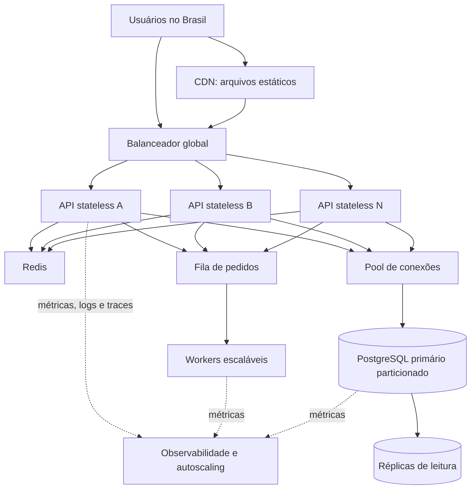

# Escalabilidade conceitual

Para atender 1 milhão de usuários e 100 mil conexões simultâneas no Brasil, seria necessário evoluir a implantação local para uma arquitetura distribuída. Réplicas stateless da API ficam atrás de um balanceador e escalam horizontalmente em Kubernetes ou Swarm. CDN entrega os arquivos estáticos perto dos usuários; Redis pode guardar dados de leitura curta, com invalidação após mudanças no cardápio. Filas desacoplam confirmação de pedidos e integrações.

O PostgreSQL pode usar pool de conexões (por exemplo, PgBouncer), réplicas de leitura e particionamento planejado conforme volume e região. Observabilidade reúne métricas, logs e traces; autoscaling ajusta réplicas por carga. Multi-região exige definir residência dos dados, consistência, failover e roteamento por região.

Orquestração espalha as réplicas por zonas e regiões. Um desenho multi-região precisa de replicação e procedimentos de recuperação testados, além de monitoramento de latência e capacidade.
